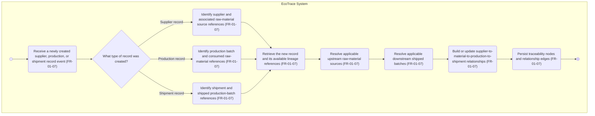

# AD-UC-06 — Maintain Carbon Traceability Linkage (Must Slice for UC-06)

## 1\. Metadata and Scope

|Field|Value|
|-|-|
|Use Case ID|UC-06|
|Use Case Name|View carbon traceability record|
|Primary Actor in W0|Sustainability \& ESG Dep.|
|Feature|F-01 — Carbon Traceability|
|Activity Scope|Must only — FR-01-07|
|Related Should Requirement|FR-01-08 — View carbon traceability record (excluded)|
|Diagram Pattern|Pattern A — single EcoTrace system swimlane|
|Status|Draft — source-aligned Must slice|

**Scope note:** The supplied Must requirement for UC-06 is FR-01-07, which maintains the linkage when supplier, production, and shipment records are created. The actual user interaction to select a shipped product batch and display its complete traceability record is FR-01-08 (Should), so it is intentionally not included in this Must-only activity diagram.

## 2\. Activity Diagram

## 3\. Node Trace

|Node ID|Node type|Activity / condition|FR trace|
|-|-|-|-|
|start1|Initial node|Start processing a newly created source record.|FR-01-07|
|s1|Action|Receive supplier, production, or shipment record-created event.|FR-01-07|
|d1|Decision|Determine which record type was created.|FR-01-07|
|s2|Action|Identify supplier and raw-material source references.|FR-01-07|
|s3|Action|Identify production batch and consumed raw-material references.|FR-01-07|
|s4|Action|Identify shipment and shipped production-batch references.|FR-01-07|
|s5|Action|Retrieve the new record and its available lineage references.|FR-01-07|
|s6|Action|Resolve applicable upstream raw-material sources.|FR-01-07|
|s7|Action|Resolve applicable downstream shipped batches.|FR-01-07|
|s8|Action|Build or update relationships across supplier, raw material, production, and shipment records.|FR-01-07|
|s9|Action|Persist traceability nodes and relationship edges.|FR-01-07|
|stop1|Final node|End processing for this created-record event.|FR-01-07|

## 4\. Branch Tests

|Test|Input / condition|Expected path|Expected outcome|
|-|-|-|-|
|BT-01|A supplier record is created.|start1 → s1 → d1 → s2 → s5 → s6 → s7 → s8 → s9 → stop1|Supplier and raw-material source references are incorporated into the traceability relationships.|
|BT-02|A production record is created.|start1 → s1 → d1 → s3 → s5 → s6 → s7 → s8 → s9 → stop1|The production batch is linked with its applicable consumed raw-material sources and downstream shipped batches.|
|BT-03|A shipment record is created.|start1 → s1 → d1 → s4 → s5 → s6 → s7 → s8 → s9 → stop1|The shipment is linked with its shipped production batch(es) and applicable upstream raw-material sources.|
|BT-04|Each of the three record types is created over the operational lifecycle.|Execute the corresponding branch for each record-created event.|The logical traceability chain can be maintained across supplier, raw material, production, and shipment records.|

**Out of scope:** A user selecting a shipped batch and viewing the traceability-record screen is FR-01-08 (Should), not a Must branch.

## 5\. Object States

|Object|State before activity|State after activity|Notes|
|-|-|-|-|
|Supplier / production / shipment record|Created|Linked in the traceability model|The activity maintains its applicable relationships; it does not define the operational record's creation process.|
|Traceability graph|Existing graph or initial graph|Updated with applicable nodes and relationship edges|Logical state only; storage topology is not prescribed by FR-01-07.|
|Raw-material-to-shipment chain|May be incomplete before all related records are available|Maintained as linked records become available|Missing-reference handling and later reconciliation need an approved rule.|

## 6\. Open Questions

1. Which operational applications publish supplier, production, and shipment record-created events? The supplied FR does not specify exact source-system names or integration protocols.
2. What are the canonical identifiers and reference fields for supplier records, raw-material lots, production batches, and shipment records?
3. When a downstream shipment does not yet exist, how should the system maintain the relationship when that shipment is later created? Is incremental linkage sufficient, or is reconciliation/backfill required?
4. What is the required behavior when an expected upstream or downstream reference is missing or invalid? The Must FR does not define reject, retry, pending, or exception handling, so no such branch is invented here.
5. Is the traceability graph a separate store, or a logical graph/data model within the existing EcoTrace database?
6. UC-06 names Sustainability \& ESG Dep. as actor, while FR-01-07 is triggered by record creation. Confirm whether the UC should be split into (a) background linkage maintenance and (b) user-facing viewing. FR-01-08 currently defines the latter as Should.

## 7\. Verification Log

|Check|Result|Note|
|-|-|-|
|Single system swimlane|Pass|One EcoTrace System lane, following the requested Pattern A approach.|
|Initial and final nodes|Pass|One initial node and one final node.|
|Record-type decision|Pass|Three guarded alternatives: Supplier, Production, and Shipment.|
|FR traceability|Pass|Every system action is mapped to FR-01-07.|
|Must-only scope|Pass|FR-01-08 and viewer behavior are excluded.|
|Unsupported exception paths|Pass|No missing-reference handling is invented.|
|Mermaid rendering / peer review|Pass|Validated in Mermaid Live Editor.|

