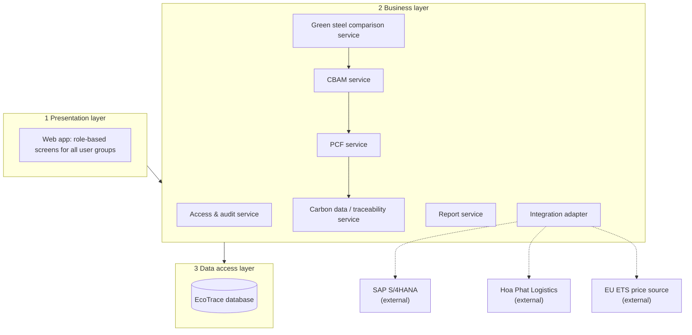

# Architecture: EcoTrace

Lesson 4 (Prof. Seki, architectural design). The steps follow the design process of the lecture:
stakeholder requirements, system requirements, functional design, physical design, three layers.
Decisions are recorded as ADRs (section 4).

| Field | Value |
|---|---|
| Version | v1.1 |
| Inputs | CVCA v1.0 (`cvca.md` (stakeholder requirements), `context_diagram.md`, `use_case_diagram.md` |

## 1. System requirements

| ID | System requirement | From |
|---|---|---|
| SyR-01 | The system shall let Procurement submit supplier and raw material carbon data. (UC-01) | StR-04 |
| SyR-02 | The system shall let Sustainability & ESG manage the GHG methodology and emission factors. (UC-02) | StR-01 |
| SyR-03 | The system shall show the carbon intensity of each production batch. (UC-03) | StR-03 |
| SyR-04 | The system shall calculate the product carbon footprint (PCF) of a shipment from its batches and logistics emissions. (UC-04) | StR-02, StR-05 |
| SyR-05 | The system shall assess Scope 3 emissions and show supplier data gaps. (UC-05) | StR-04 |
| SyR-06 | The system shall show the carbon traceability record from raw material to shipped batch. (UC-06) | StR-02, StR-09 |
| SyR-07 | The system shall estimate the CBAM cost of a shipment. (UC-07) | StR-05 |
| SyR-08 | The system shall let the Compliance team configure CBAM regulatory parameters. (UC-08) | StR-05 |
| SyR-09 | The system shall compare green steel options and generate a recommendation. (UC-09) | StR-07, StR-08 |
| SyR-10 | The system shall let users sign in. (UC-10) | StR-10 |
| SyR-11 | The system shall let the System admin configure roles and access rights. (UC-11) | StR-10 |
| SyR-12 | The system shall let the Auditor monitor and export audit logs. (UC-12) | StR-09, StR-10 |
| SyR-13 | The system shall receive production, energy, order and shipment data from SAP/ERP and batch-shipment links from Hoa Phat Logistics. | StR-03, StR-05, StR-06, StR-10 |

StR-11 (Executive Board) and StR-12 (Finance & Accounting) have no system requirement yet; see
section 5, point 3.

## 2. Functional design

The system requirements divided into subordinate functions.

| Function | Serves |
|---|---|
| Identify the user and the role, and enforce access | SyR-10, SyR-11, all |
| Record who did what (audit trail) | SyR-12 |
| Receive data from SAP/ERP and Hoa Phat Logistics | SyR-13, SyR-03, SyR-04 |
| Save supplier and raw material carbon data | SyR-01, SyR-05 |
| Keep GHG methodology and emission factors | SyR-02 |
| Calculate batch carbon intensity | SyR-03 |
| Link raw material, batch and shipment (traceability) | SyR-04, SyR-06 |
| Calculate shipment-level PCF | SyR-04 |
| Assess Scope 3 emissions and supplier gaps | SyR-05 |
| Estimate CBAM cost and keep regulatory parameters | SyR-07, SyR-08 |
| Score and compare green steel options | SyR-09 |
| Produce and export reports and evidence | SyR-04, SyR-06, SyR-07, SyR-09 |

## 3. Physical design

Each function allocated to an element of the system.

Solid arrows run from layer to layer; dotted arrows go to external systems. Inside the business
layer, the CBAM service uses the result of the PCF service, the comparison service uses both, and
the PCF service reads batch linkage and batch carbon intensity from the Carbon data / traceability
service. The Access & audit service checks every request from the web app. The Integration adapter is
the only element that talks to external systems. The Report service is called by the PCF, CBAM and
comparison services.

| Function | Element | Layer |
|---|---|---|
| Identify the user and the role, and enforce access | Web app with Access & audit service (ADR-003) | Presentation, Business |
| Record who did what (audit trail) | Access & audit service | Business |
| Receive data from SAP/ERP and Hoa Phat Logistics | Integration adapter with SAP S/4HANA and Hoa Phat Logistics (ADR-002) | Business, external |
| Save supplier and raw material carbon data | Carbon data / traceability service | Business |
| Keep GHG methodology and emission factors | Carbon data / traceability service | Business |
| Calculate batch carbon intensity | Carbon data / traceability service | Business |
| Link raw material, batch and shipment (traceability) | Carbon data / traceability service | Business |
| Calculate shipment-level PCF | PCF service | Business |
| Assess Scope 3 emissions and supplier gaps | Carbon data / traceability service | Business |
| Estimate CBAM cost and keep regulatory parameters | CBAM service with Integration adapter and EU ETS price source | Business, external |
| Score and compare green steel options | Green steel comparison service | Business |
| Produce and export reports and evidence | Report service | Business |
| Keep supplier data, batches, PCF records, parameters, users, audit log | EcoTrace database (ADR-004) | Data access |

All screens of Lesson 8 are elements of the presentation layer. Their data sources are the data
groups of W0 Table 4.

## 4. Decisions

| ADR | Decision | Status |
|---|---|---|
| ADR-001 | One responsive web app for all user groups, no native app | Proposed |
| ADR-002 | All data from SAP S/4HANA, Hoa Phat Logistics and the EU ETS price source goes through one Integration adapter | Proposed |
| ADR-003 | Sign-in, roles (RBAC) and the audit log are kept inside the platform, in the Access & audit service | Proposed |
| ADR-004 | Every PCF and CBAM result is stored with its inputs, methodology version and regulation version | Proposed |

## 5. Open points

| # | Point | Default applied |
|---|---|---|
| 1 | SAP S/4HANA is a partner in the CVCA but not an external entity in the Context Diagram, where SAP data arrives as the flow "SAP / ERP data" from Technology & Digital Transformation. The EU ETS price source (used in the W1 function list) is in neither diagram. | Both drawn as external systems here; update the Context Diagram. |
| 2 | The CVCA and the Context Diagram do not list the same parties. CVCA only: Domestic End-users, SAP S/4HANA, HPDQ Executive Board. Context Diagram only: Data & AI partner, Green Finance Partner. | Not allocated to any element in v1. |
| 3 | StR-11 (Executive Board approvals) and StR-12 (Finance & Accounting ROI and green-finance MRV) have no use case. | No system requirement written for them in v1. |
| 4 | BSI receives reports and evidence; no direct system link is drawn. | Reports are exported by the Report service and sent outside the system. |
| 5 | Sign-in mechanism (platform accounts or HPDQ corporate sign-in) is not decided. | Platform accounts with roles (ADR-003). |

## Change log

| Version | When | Change | Why |
|---|---|---|---|
| v1 | Lesson 1 | Web app, Access & audit service, Carbon data / traceability service, PCF service, CBAM service, Green steel comparison service, Report service, Integration adapter, database | First draft |
| v2 | Lesson 4 | "From" column now uses the official StR-01 to StR-12 of the CVCA; draft stakeholder table removed; inputs name the official CVCA and Context Diagram; open points updated | CVCA and Context Diagram finalized |
