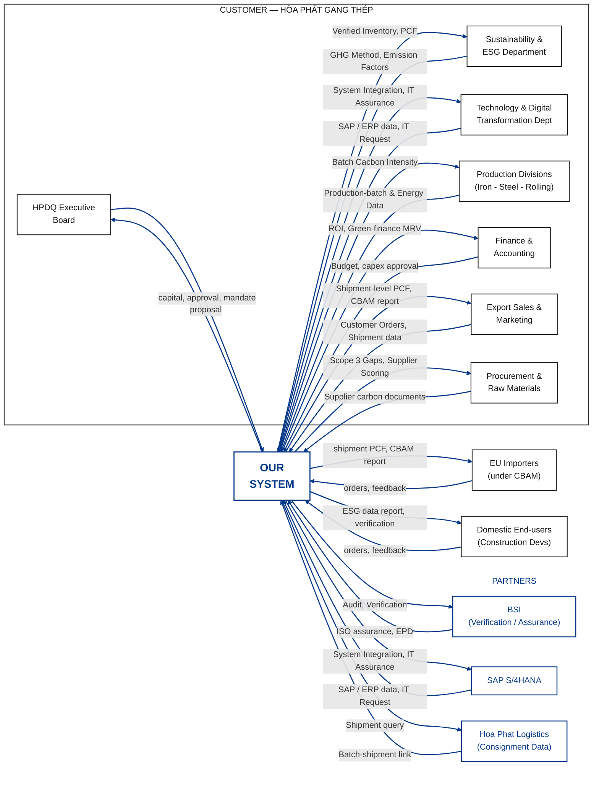

# CVCA: EcoTrace

The Customer Value Chain Analysis (CVCA) describes the stakeholders around EcoTrace and the value exchanged between them, including information, approvals, services, and assurance. It is a business-level view used to identify problems and opportunities before defining detailed system behavior.

| Field | Value |
|---|---|
| Project | HPDQ Carbon Management & Reporting System (EcoTrace) |
| Version | v1.0 |
| Source | DBIZ I CVCA |
| Next | [Context Diagram](context-diagram.md) |

## 1. Value chain (with the new system)

The diagram represents the value chain **with EcoTrace**. It preserves the nodes, arrow directions, and flow labels of the team's approved v1, without a separate Before view.

## 2. Problems and opportunities

The following are business needs inferred from the value exchanges in the CVCA, rather than confirmed findings from stakeholder interviews.

| # | Stakeholder | Problem or opportunity |
|---|---|---|
| P-1 | Sustainability & ESG; Production Divisions | GHG methods, emission factors, and production/energy records come from different sources. There is an opportunity to consolidate them into consistent carbon inventory and PCF information. |
| P-2 | Production Divisions | Batch-level carbon intensity needs to be associated with production batches and their energy data to make the results useful to operations. |
| P-3 | Procurement & Raw Materials | Supplier carbon documents need to be consolidated so that Scope 3 data gaps can be identified and supplier information can be assessed. |
| P-4 | Export Sales & Marketing; Hoa Phat Logistics | Shipment information and batch-shipment links must be brought together to support shipment-level PCF and CBAM reporting. |
| P-5 | EU Importers; Domestic End-users | Steel buyers need accessible carbon information, including shipment PCF/CBAM information for EU importers and ESG/verification information for domestic customers. |
| P-6 | BSI; Sustainability & ESG | Carbon outputs need an independent assurance route so that verification findings can support the credibility of the information provided. |
| P-7 | Technology & Digital Transformation Dept; SAP S/4HANA | EcoTrace depends on usable SAP/ERP information and suitable system integration and IT assurance. |
| P-8 | HPDQ Executive Board; Finance & Accounting | Investment proposals, approvals, budgets, and performance/ROI information need to be linked to the system's expected business value. |

## 3. Stakeholder requirements

Written as **"<stakeholder> shall be able to ..."**, following the requirement style of Prof. Seki's LabDesk example. Each requirement traces back to an opportunity in Section 2; these are stakeholder-level needs, not detailed use cases.

| ID | Stakeholder requirement | From |
|---|---|---|
| StR-01 | The Sustainability & ESG Department shall be able to provide GHG methods and emission factors for carbon assessment. | P-1 |
| StR-02 | The Sustainability & ESG Department shall be able to obtain carbon inventory and PCF information from EcoTrace. | P-1 |
| StR-03 | Production Divisions shall be able to provide production-batch and energy data and obtain batch carbon intensity information. | P-2 |
| StR-04 | Procurement & Raw Materials shall be able to provide supplier carbon documents and identify Scope 3 gaps and supplier assessment information. | P-3 |
| StR-05 | Export Sales & Marketing shall be able to supply customer order and shipment information and obtain shipment-level PCF and CBAM reports. | P-4 |
| StR-06 | Hoa Phat Logistics shall be able to provide batch-shipment links in response to shipment queries. | P-4 |
| StR-07 | EU Importers shall be able to obtain shipment PCF and CBAM information and provide orders or feedback. | P-5 |
| StR-08 | Domestic End-users shall be able to obtain ESG reporting and verification information and provide orders or feedback. | P-5 |
| StR-09 | BSI shall be able to assess EcoTrace outputs for audit/verification and provide independent assurance findings. | P-6 |
| StR-10 | The Technology & Digital Transformation Department shall be able to coordinate SAP/ERP data exchange, system integration, and IT assurance. | P-7 |
| StR-11 | The HPDQ Executive Board shall be able to review system proposals and provide the required approval and mandate. | P-8 |
| StR-12 | Finance & Accounting shall be able to review relevant budget/capex information and obtain ROI and green-finance MRV information. | P-8 |
