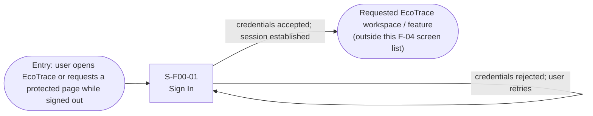
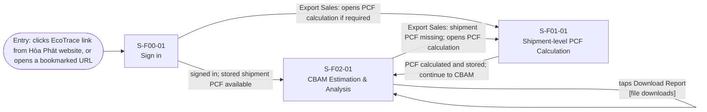
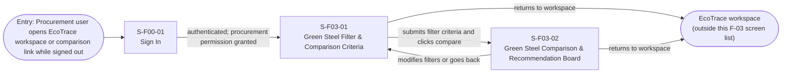

# Screen Transition Diagram: EcoTrace

## 1. All users

The sign-in flow ends at the destination the user originally requested. The destination may belong to another EcoTrace feature and is therefore outside this Feature 4 screen list.

## 7. Export Sales & Marketing / Procurement & Raw Materials

UC-04 (`S-F01-01`) prepares missing shipment-level PCF for Export Sales & Marketing. UC-07 (`S-F02-01`) loads the stored shipment record and verified carbon-intensity inputs (FR-02-01), validates eligibility and required fields (FR-02-02), and calculates CBAM embedded emissions separately (FR-02-03). The documents do not equate shipment PCF with CBAM embedded emissions. Procurement uses UC-07 with pre-existing valid shipment/carbon data; UC-04 is not an automatic step.

## 10. Customers

## 11. System Admin

## 12. Auditor / System Admin

## 13. Compliance / Product Owner

`M-F02-03` is a confirmation modal over `S-F02-03`, **not** another screen. Access-denied, invalid-draft and cancellation outcomes are states of existing screens, not separate Screen IDs. UC-08 covers FR-02-14 to FR-02-17 and shared access/audit controls.

## Checks (chưa fix)

- Screen IDs: 9 of 9 IDs in `screen-list.md` are referenced in the diagrams (static check; final review pending).
- Every screen reachable from an entry point: yes.
- No dead ends: yes.
- Usage-flow paths: F-02 and existing mapped paths appear below; full cross-feature coverage remains pending team review.
- Sign in is shared; signed-out users who open an email or QR link see S-F00-01 first and then
  return to the screen they asked for (screen-level rule in S-F00-01).

## Usage-flow paths

|Usage-flow arrow|Path on this diagram|
|-|-|
|UC-09 to UC-09|Customers: `S-F00-01` → `S-F03-01` (authenticated; procurement permission granted) → `S-F03-02` (submits filter criteria and clicks compare). |
|UC-10 to UC-11|System Admin: `S-F00-01` → `S-F04-01` (authenticated; permission granted).|
|UC-10 to UC-12|System Admin / Auditor: `S-F00-01` → `S-F04-02` (authenticated; audit-view permission granted).|
|UC-11 to UC-12|System Admin: `S-F04-01` → `S-F04-02` (opens Audit Logs).|
|UC-10 to UC-04|Export Sales & Marketing: `S-F00-01` → `S-F01-01` (signed in; opens shipment-level PCF calculation).|
|UC-04 to UC-07 (if PCF required)|Export Sales & Marketing: `S-F01-01` → `S-F02-01` (PCF calculated and stored; user proceeds to CBAM estimation).|
|UC-10 to UC-07|Export Sales & Marketing / Procurement & Raw Materials: `S-F00-01` → `S-F02-01` (signed in; stored shipment PCF available; UC-07 validates verified carbon intensity and other required inputs).|
|UC-10 to UC-08|Compliance / Product Owner: `S-F00-01` → `S-F02-02` (authenticated; view permission granted).|
|UC-08 rule maintenance|Compliance / Product Owner: `S-F02-02` → `S-F02-03` (create/edit permitted) → `S-F02-02` (after successful activation or return). `M-F02-03` is a modal on `S-F02-03`, not a separate screen.|

