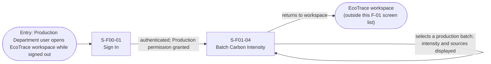
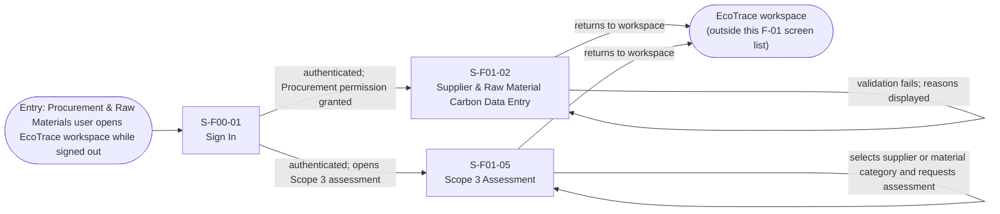
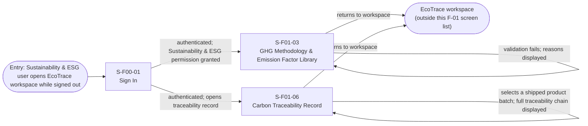
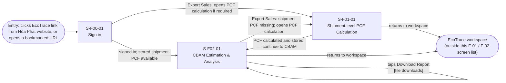
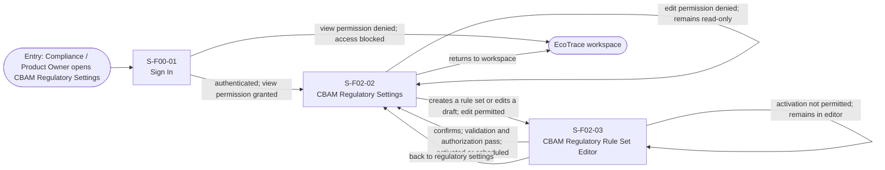
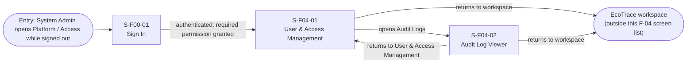
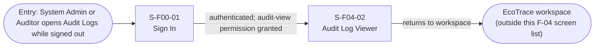

# Screen Transition Diagram: EcoTrace

## 1. All users

The sign-in flow ends at the destination the user originally requested. The destination may belong to another EcoTrace feature and is therefore outside this Feature 4 screen list.

## 2. Production Department

The batch carbon intensity is calculated in the background (FR-01-03); `S-F01-04` only displays it.

## 3. Procurement & Raw Materials Department

## 4. Sustainability & ESG Department

The traceability links between raw material, production batch and shipment are created in the background when records are saved (FR-01-07); `S-F01-06` only displays them.

## 5. Export Sales & Marketing / Procurement & Raw Materials Department

UC-04 (`S-F01-01`) is an optional preparation step for Export Sales & Marketing when valid shipment PCF is not yet available. With existing verified carbon/PCF inputs, Export Sales & Marketing or Procurement & Raw Materials proceeds directly to UC-07 (`S-F02-01`).

## 6. Compliance / Product Owner

`M-F02-03` is a confirmation modal over `S-F02-03`, **not** another screen. Access-denied, invalid-draft and cancellation outcomes are states of existing screens, not separate Screen IDs. UC-08 covers FR-02-14 to FR-02-17 and shared access/audit controls.

## 7. Customers

## 8. System Admin

## 9. Auditor / System Admin

## Checks
- [x] Every screen in the Screen List appears in exactly one or more of the diagrams.
- [x] Every screen is reachable from an entry point.
- [x] No dead end: every screen has a way out (back, home, or a next step).
- [x] The main task of each actor reaches its result in three screens or fewer from the start
screen, or the team has written down why not.
- [x] Every arrow label is a user action or a system event, never a screen name.
- [x] Usage-flow paths: for every arrow "UC-a to UC-b" in usage-flow.md there is a path from a
screen of UC-a to a screen of UC-b, or UC-b starts from an entry point (email link, QR
code) because the actor leaves the product in between. Fill the table below.
- [x] The diagram renders on mermaid.live.

## Usage-flow paths

|Usage-flow arrow|Path on this diagram|
|-|-|
|UC-10 to UC-01|Procurement & Raw Materials: `S-F00-01` → `S-F01-02` (authenticated; Procurement permission granted).|
|UC-10 to UC-02|Sustainability & ESG: `S-F00-01` → `S-F01-03` (authenticated; Sustainability & ESG permission granted).|
|UC-10 to UC-03|Production: `S-F00-01` → `S-F01-04` (authenticated; Production permission granted).|
|UC-10 to UC-05|Procurement & Raw Materials: `S-F00-01` → `S-F01-05` (authenticated; opens Scope 3 assessment).|
|UC-10 to UC-06|Sustainability & ESG: `S-F00-01` → `S-F01-06` (authenticated; opens traceability record).|
|UC-10 to UC-04|Export Sales & Marketing: `S-F00-01` → `S-F01-01` (signed in; opens shipment-level PCF calculation).|
|UC-04 to UC-07 (if PCF required)|Export Sales & Marketing: `S-F01-01` → `S-F02-01` (PCF calculated and stored; user proceeds to CBAM estimation).|
|UC-10 to UC-07|Export Sales & Marketing / Procurement & Raw Materials: `S-F00-01` → `S-F02-01` (signed in; stored shipment PCF available; UC-07 validates verified carbon intensity and other required inputs).|
|UC-10 to UC-08|Compliance / Product Owner: `S-F00-01` → `S-F02-02` (authenticated; view permission granted).|
|UC-08 rule maintenance|Compliance / Product Owner: `S-F02-02` → `S-F02-03` (create/edit permitted) → `S-F02-02` (after successful activation or return). `M-F02-03` is a modal on `S-F02-03`, not a separate screen.|
|UC-10 to UC-09|Customers: `S-F00-01` → `S-F03-01` → `S-F03-02` (authenticated; submits comparison criteria and starts comparison).||UC-10 to UC-11|System Admin: `S-F00-01` → `S-F04-01` (authenticated; permission granted).|
|UC-10 to UC-12|System Admin / Auditor: `S-F00-01` → `S-F04-02` (authenticated; audit-view permission granted).|
|UC-11 to UC-12|System Admin: `S-F04-01` → `S-F04-02` (opens Audit Logs).|

