# Usage Flow: EcoTrace

| Field | Value |
|---|---|
| Product | EcoTrace (HPDQ Carbon Management & Reporting) |
| Version | v0.2 (actor-organized integration draft) |
| Date | 2026-11-07 |
| Sources | `docs/function-list/W0_Scope.md`; Use Case Diagram; `docs/activity/`; `docs/external-design/screen-list.md` |

> Usage flows are grouped **by actor**, then **by distinct actor goal**. Each Mermaid box represents a Use Case, not a click or screen. The original group flows are retained; F-02 (UC-07 and UC-08) is added under the actors already present, rather than under a separate feature heading. Sign-in (UC-10) is a shared F-04 use case and only applies when the user needs to authenticate; an existing session proceeds to the destination UC.

## All Users

### Sign in to access EcoTrace

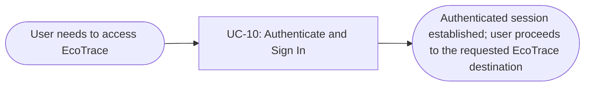

|Step|Use case|Activity diagram|Screens (fill in after Block 2)|
|-|-|-|-|
|1|UC-10 Authenticate and Sign In|`docs/activity/AD-UC-10.md`|`S-F00-01`|

## Procurement

### Record supplier and raw material carbon data

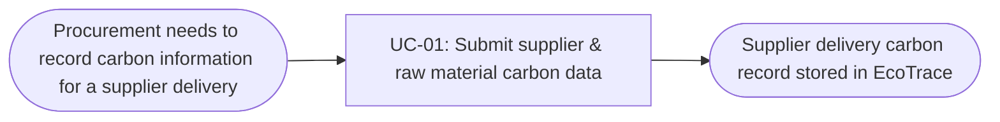

|Step|Use case|Activity diagram|Screens (fill in after Block 2)|
|-|-|-|-|
|1|UC-01 Submit supplier & raw material carbon data|`docs/activity/AD-UC-01.md`|-|

### Assess Scope 3 emissions

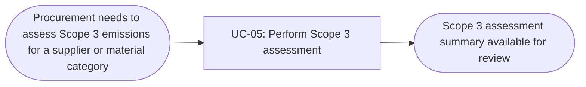

|Step|Use case|Activity diagram|Screens (fill in after Block 2)|
|-|-|-|-|
|1|UC-05 Perform Scope 3 assessment|`docs/activity/AD-UC-05.md` **(not present in current activity-diagram set)**|-|

### Estimate CBAM exposure for procurement decisions (Procurement & Raw Materials)

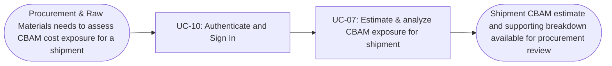

|Step|Use case|Activity diagram|Screens (fill in after Block 2)|
|-|-|-|-|
|1|UC-10 Authenticate and Sign In|`docs/activity/AD-UC-10.md`|`S-F00-01`|
|2|UC-07 Estimate & analyze CBAM exposure for shipment|`docs/activity/AD-UC-07.md`|`S-F02-01`|

## Sustainability & ESG

### Manage GHG methodology and emission factors

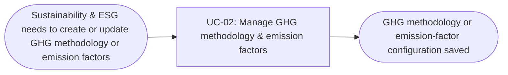

|Step|Use case|Activity diagram|Screens (fill in after Block 2)|
|-|-|-|-|
|1|UC-02 Manage GHG methodology & emission factors|`docs/activity/AD-UC-02.md` **(not present in current activity-diagram set)**|-|

### View carbon traceability record

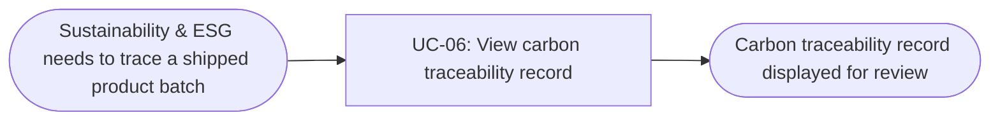

|Step|Use case|Activity diagram|Screens (fill in after Block 2)|
|-|-|-|-|
|1|UC-06 View carbon traceability record|`docs/activity/AD-UC-06.md`|-|

## Production

### Access batch carbon intensity

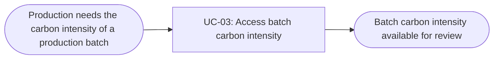

|Step|Use case|Activity diagram|Screens (fill in after Block 2)|
|-|-|-|-|
|1|UC-03 Access batch carbon intensity|`docs/activity/AD-UC-03.md` **(not present in current activity-diagram set)**|-|

## Export Sales & Marketing

### Calculate shipment-level PCF

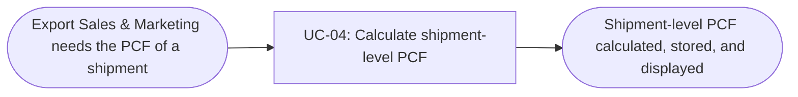

|Step|Use case|Activity diagram|Screens (fill in after Block 2)|
|-|-|-|-|
|1|UC-04 Calculate shipment-level PCF|`docs/activity/AD-UC-04.md`|`S-F01-01`|

### Estimate CBAM exposure for an export shipment

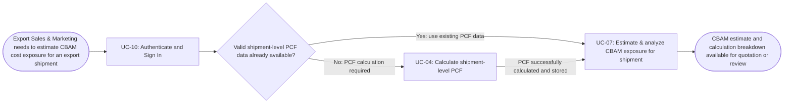

|Step|Use case|Activity diagram|Screens (fill in after Block 2)|
|-|-|-|-|
|1|UC-10 Authenticate and Sign In|`docs/activity/AD-UC-10.md`|`S-F00-01`|
|2 (if required)|UC-04 Calculate shipment-level PCF|`docs/activity/AD-UC-04.md`|`S-F01-01`|
|3|UC-07 Estimate & analyze CBAM exposure for shipment|`docs/activity/AD-UC-07.md`|`S-F02-01`|

> **Dependency:** UC-07 requires valid shipment and verified carbon/PCF data. UC-04 calculates and stores shipment-level PCF. When valid PCF data already exists, the user can proceed directly to UC-07 without recalculating it. Otherwise, UC-04 may be performed first to prepare the required PCF data. This is a conditional user journey, not an automatic system invocation of UC-04. If required inputs remain missing or invalid, UC-07 blocks estimation and displays validation reasons (FR-02-02).

## Compliance / Product Owner

### Manage CBAM regulatory rules and parameters

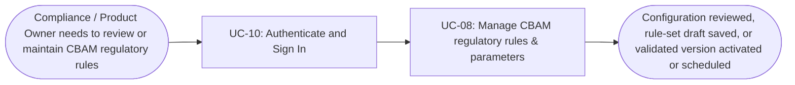

|Step|Use case|Activity diagram|Screens (fill in after Block 2)|
|-|-|-|-|
|1|UC-10 Authenticate and Sign In|`docs/activity/AD-UC-10.md`|`S-F00-01`|
|2|UC-08 Manage CBAM regulatory rules & parameters|`docs/activity/AD-UC-08.md`|`S-F02-02`, `S-F02-03` (when creating/editing)|

> In UC-08, `S-F02-02` is the settings view and `S-F02-03` is the rule-set editor. `M-F02-03` is an activation-confirmation modal, not an additional use case or screen.

## System Admin

### Administer user access

|Step|Use case|Activity diagram|Screens (fill in after Block 2)|
|-|-|-|-|
|1|UC-10 Authenticate and Sign In|`docs/activity/AD-UC-10.md`|`S-F00-01`|
|2|UC-11 Manage User Access (working title)|`AD-UC-11.md` **(not present in current activity-diagram set)**|`S-F04-01`|

### Review platform activity (also available to Auditor)

|Step|Use case|Activity diagram|Screens (fill in after Block 2)|
|-|-|-|-|
|1|UC-10 Authenticate and Sign In|`docs/activity/AD-UC-10.md`|`S-F00-01`|
|2|UC-12 Review Audit Logs (working title)|`AD-UC-12.md` **(not present in current activity-diagram set)**|`S-F04-02`|

## Customer

### Compare and select green steel options

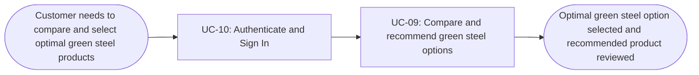
|Step|Use case|Activity diagram|Screens (fill in after Block 2)|
|-|-|-|-|
|1|UC-10 Authenticate and Sign In|`docs/activity/AD-UC-10.md`|`S-F00-01`|
|2|UC-09 Compare and recommend green steel options|`docs/activity/AD-UC-09.md`|`S-F03-01, S-F03-02`|

## Use cases without a flow (ai làm thì xóa dòng mặc định và ghi chú này)

| Use case | Started by | Described in |
|---|---|---|
| UC-05 Release no-show seats | Time (15 minutes after a slot starts) | `AD-UC-05.md`; the student only sees the result as an email |

## Checks before you save (chưa fix)

- [x] Every actor that starts a use case has at least one flow.
- [x] An actor with clearly different goals has one flow per goal; no flow has more than about
      9 boxes (Student 4 use cases, Lab Technician 2).
- [x] Every actor name matches the Use Case Diagram and the Context Diagram.
- [x] Coverage: UC-01 to UC-04 (Must) and UC-06, UC-07 (Should) each appear in a flow with the
      same ID and name; UC-05 is listed under "Use cases without a flow"; no Won't-have use case
      appears.
- [x] No box is a click or a screen; no box tells two use cases.
- [x] Every flow renders on mermaid.live.
- [x] Every step has at least one screen, and every screen in `screen-list.md` appears in some step.
