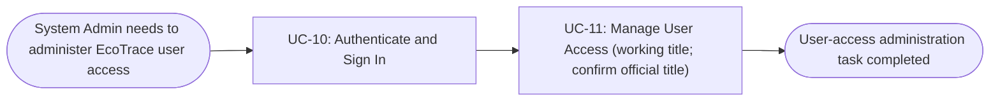
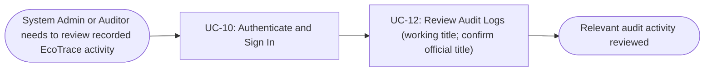

# Usage Flow: EcoTrace

> Worked example for teaching. Not a student submission and not a real product.

| Field | Value |
|---|---|
|Product|EcoTrace|
|Version|v0.1 (draft)|
|Date|2026-11-06|
| Sources | W0 Table 1 (use case inventory); Use Case Diagram; `docs/activity/activity-index.md` |

## Before you draw: is Lesson 4 still true? (chưa fix)

- [x] Every row of the Inputs check table in `docs/activity/activity-index.md` is "Done" or logged
      as an open question. Row 3 (a scheduler for timed jobs) was closed in the Lesson 4
      architecture with ADR-004; row 4 (split the "Booking flow" sequence) is still open and owned
      by Owner A.

## All Users: sign in to access EcoTrace

|Step|Use case|Activity diagram|Screens (fill in after Block 2)|
|-|-|-|-|
|1|UC-10 Authenticate and Sign In|`docs/activity/AD-UC-10.md`|`S-F00-01`|

## System Admin: administer user access

|Step|Use case|Activity diagram|Screens (fill in after Block 2)|
|-|-|-|-|
|1|UC-10 Authenticate and Sign In|`docs/activity/AD-UC-10.md`|`S-F00-01`|
|2|UC-11 Manage User Access (working title)|`AD-UC-11.md` **(not present in current activity-diagram set)**|`S-F04-01`|

## System Admin / Auditor: review platform activity

|Step|Use case|Activity diagram|Screens (fill in after Block 2)|
|-|-|-|-|
|1|UC-10 Authenticate and Sign In|`docs/activity/AD-UC-10.md`|`S-F00-01`|
|2|UC-12 Review Audit Logs (working title)|`AD-UC-12.md` **(not present in current activity-diagram set)**|`S-F04-02`|

## Use cases without a flow (ai làm thì xóa dòng mặc định và ghi chú này)

| Use case | Started by | Described in |
|---|---|---|
| UC-05 Release no-show seats | Time (15 minutes after a slot starts) | `AD-UC-05.md`; the student only sees the result as an email |

## Checks before you save (chưa fix)

- [x] Every actor that starts a use case has at least one flow.
- [x] An actor with clearly different goals has one flow per goal; no flow has more than about
      9 boxes (Student 4 use cases, Lab Technician 2).
- [x] Every actor name matches the Use Case Diagram and the Context Diagram.
- [x] Coverage: UC-01 to UC-04 (Must) and UC-06, UC-07 (Should) each appear in a flow with the
      same ID and name; UC-05 is listed under "Use cases without a flow"; no Won't-have use case
      appears.
- [x] No box is a click or a screen; no box tells two use cases.
- [x] Every flow renders on mermaid.live.
- [x] Every step has at least one screen, and every screen in `screen-list.md` appears in some step.
