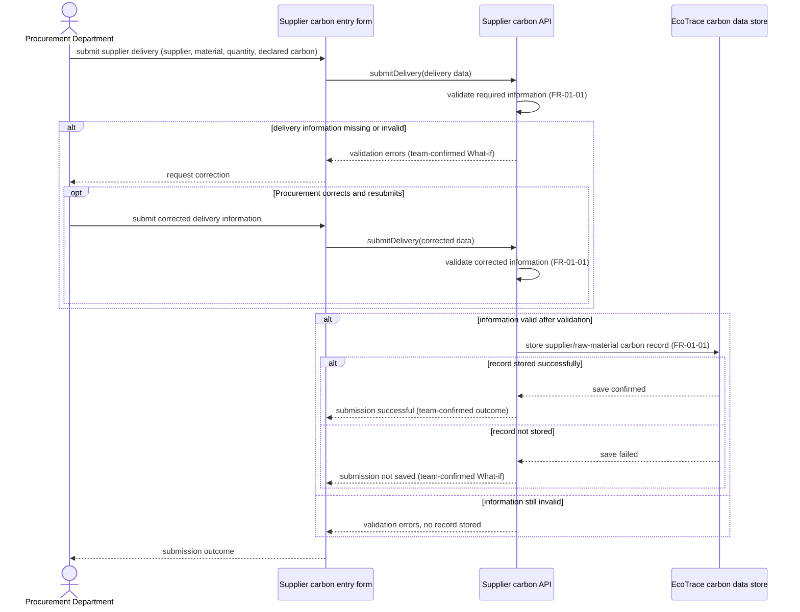

# Sequence Diagram: SD-UC-01 Submit supplier & raw material carbon data

Lesson 4, analysis level: how EcoTrace components interact when the Procurement Department submits supplier-delivery carbon information. The actions of correcting and resubmitting input belong to [AD-UC-01](../activity/AD-UC-01.md); this sequence shows the internal validation and persistence outcomes. 

| Field | Value |
|---|---|
| Use case | **UC-01 Submit supplier & raw material carbon data** (W1) |
| Primary actor | Procurement Department |
| Version | v1.0 |
| FRs | **FR-01-01 (Must)** |
| Sources | Midterm Excel: W1 `FR-01-01-FE` (supplier/raw-material entry form), `FR-01-01-BE` (API: validate and store carbon record), W4 Must; team-approved AD-UC-01 v0.3 |

The `alt` fragments represent **system-decided outcomes**: validation result and save result. The optional user resubmission is marked `opt` because it is **the Procurement Department's choice**, already described in the activity diagram, not an automatic system retry.

**Traceability and limits:** W1 directly specifies capturing supplier identity, raw material type, quantity, and supplier-declared carbon data; its BE work item says “validate and store.” Correction messages, save-failure reporting, and success reporting were accepted during the team's AD-UC-01 What-if discussion, but are **not separate SHALL statements in W1**. The exact validation rules, storage technology, transaction semantics, and whether retries can occur multiple times are unspecified. The `opt` only illustrates one possible resubmission; the second validation result governs whether saving proceeds.
