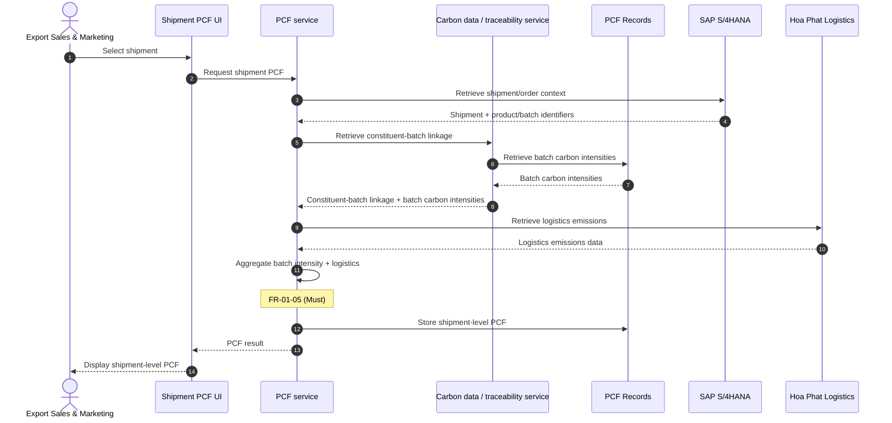

# UC-04: Calculate shipment-level PCF

| Field | Value |
|---|---|
| Use case | UC-04 Calculate shipment-level PCF |
| Version | v1 |
| FRs | FR-01-05 (core calculation). Supporting data: FR-01-03 (batch carbon intensity), FR-01-07 (traceability linkage) |

## Diagram

