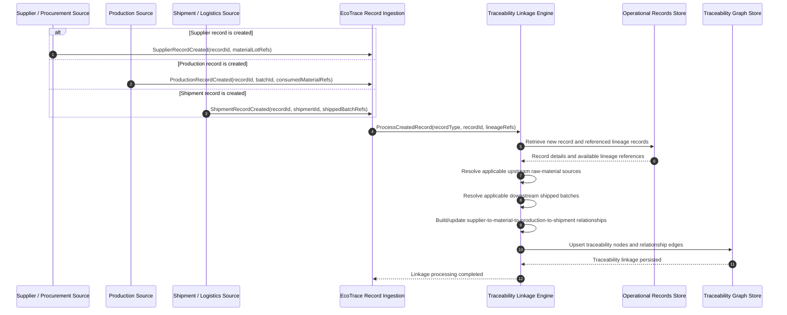

# Sequence Diagram: SD-UC-06 View carbon traceability record (Must-only)   

This sequence models the background traceability-linkage behavior required by FR-01-07. Whenever a supplier, production, or shipment record is created, EcoTrace processes the new record and maintains the applicable relationships connecting supplier/raw-material sources, production batches, and shipped batches.

| Field | Value |
|---|---|
| Use case | UC-06 View carbon traceability record |
| Version | v1 |
| FRs | FR-01-08 |

