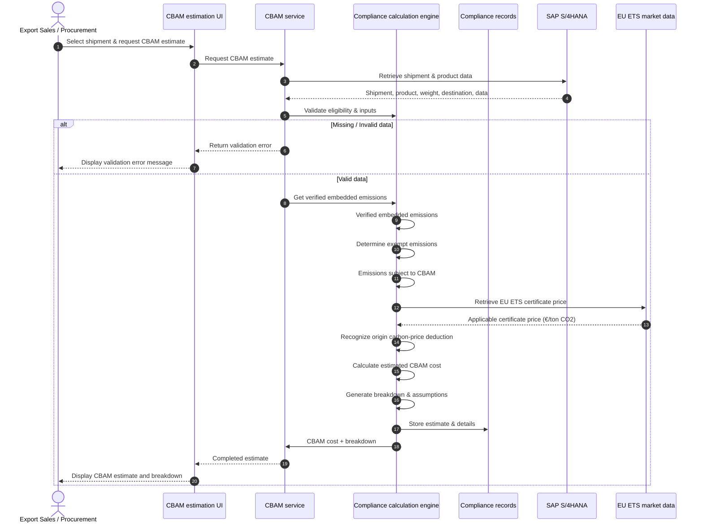

# UC-07: Estimate & Analyze CBAM exposure for shipment

| Field | Value |
|---|---|
| Use case | UC-07 Estimate & Analyze CBAM exposure for shipment |
| Version | v1 |
| FRs | FRs	FR-02-01, FR-02-02, FR-02-03, FR-02-04, FR-02-05, FR-02-06, FR-02-07, FR-02-08, FR-02-09 |

## Diagram

