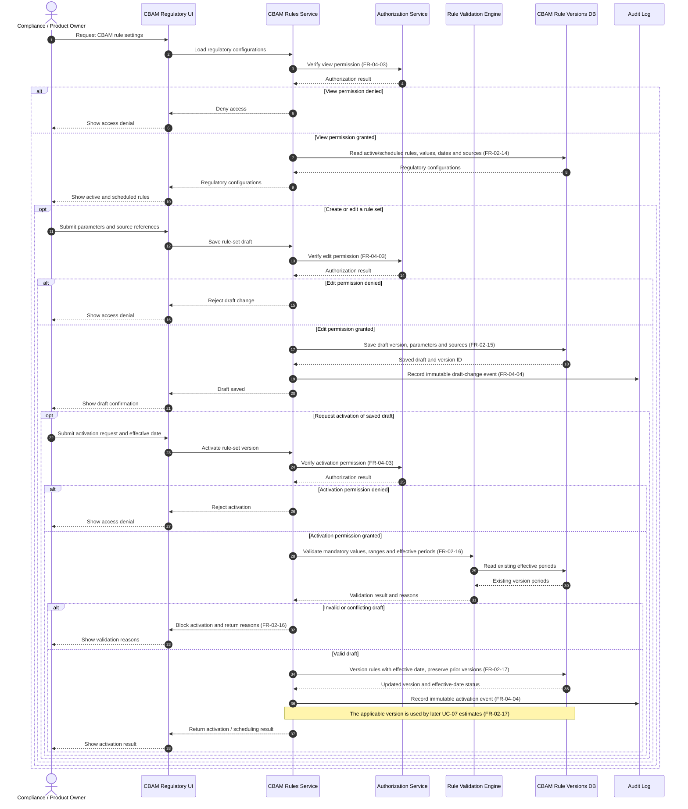

# Sequence Diagram: SD-UC-08 Manage CBAM Regulatory Rules & Parameters

Lesson 4, analysis level: how EcoTrace components cooperate when a Compliance / Product Owner opens CBAM regulatory settings, saves a rule-set draft, and optionally requests activation. The actor's choices and business-level outcomes appear in [AD-UC-08](../activity/AD-UC-08.md); this sequence focuses on requests and responses between system components.

| Field | Value |
|---|---|
| Use case | **UC-08 Manage CBAM regulatory rules & parameters** |
| Primary actor | Compliance / Product Owner |
| Version | v1.0 |
| FRs | **FR-02-14, FR-02-15, FR-02-16, FR-02-17 (UC-08 Must)**; shared **FR-04-03 (UC-11 Must), FR-04-04 (UC-12 Must)** |
| Sources | Midterm W0: UC-08, F-02; W1 Function List: `FR-02-14-FE/BE` (view active and scheduled configurations), `FR-02-15-FE/BE` (draft form and persistence), `FR-02-16-BE/FE` (activation validation and error feedback), `FR-02-17-BE/FE` (versioning, effective dates and activation), `FR-04-03-BE` (authorization middleware), `FR-04-04-BE` (audit event listener); W4 Must; [AD-UC-08](../activity/AD-UC-08.md) v0.2. |
| Preconditions | The Compliance / Product Owner has already signed in (UC-10); this sequence does not repeat login. RBAC permissions are checked before protected view, edit and activation requests. |

## Diagram

## Interaction notes

The three authorization checks apply **FR-04-03** to three protected requests: viewing regulatory configurations, saving a draft, and activating a version. This is an analysis-level representation of authorization at each protected action. **W1 does not specify distinct permission-key names** for view, edit and activate.

The nested `opt` fragments represent actions the Compliance / Product Owner may choose not to perform. The `alt` fragments distinguish authorization outcomes and activation-validation outcomes. The [activity diagram](../activity/AD-UC-08.md) shows the actor's choices and business outcomes; this sequence shows the messages exchanged between EcoTrace components. The activity diagram currently abstracts edit/activation authorization into its entry check; the two diagrams should be reconciled during review if action-specific denial paths need to be shown in both.

**Traceability and limits:** FR-02-14 displays active and scheduled rule configurations, including values, effective dates and sources. FR-02-15 saves drafts. FR-02-16 prevents activation when required values are missing, ranges are invalid, or effective periods conflict. FR-02-17 preserves prior versions and applies the effective-date version to new UC-07 estimates. FR-04-04 records immutable audit events for completed system-altering actions. The precise parameter ranges, permission identifiers, scheduling mechanism, behavior on database/audit failures and retry rules are **not defined in W1**; therefore this diagram does not prescribe those details.
