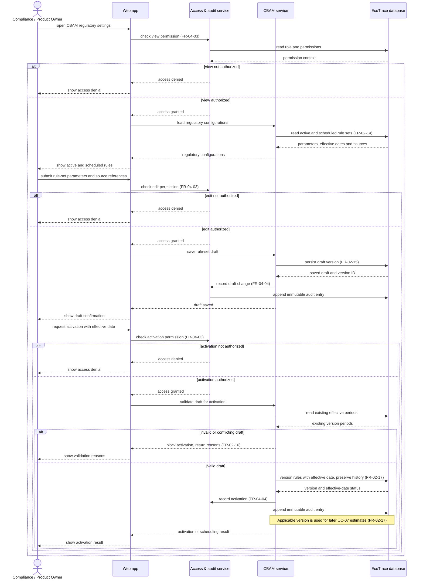

# Sequence Diagram: SD-UC-08 Manage CBAM regulatory rules & parameters

| Field | Value |
|---|---|
| Use case | UC-08 Manage CBAM regulatory rules & parameters |
| Version | v1.0 |
| FRs | FR-02-14 to FR-02-17; shared FR-04-03, FR-04-04 |

