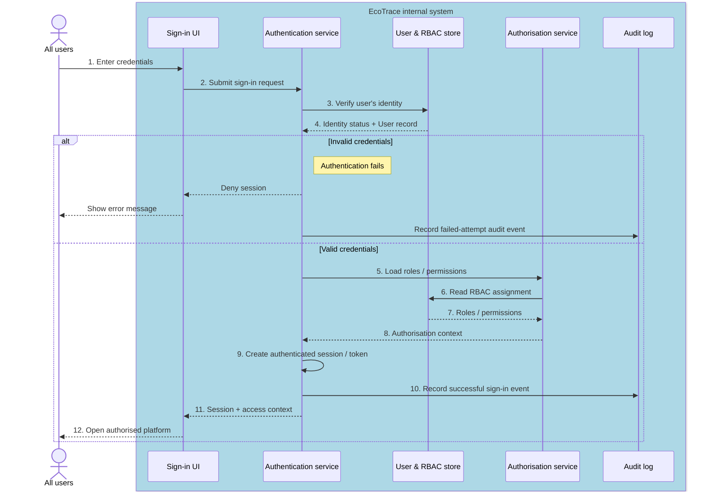

# Sequence Diagram: SD-UC-10 Authenticate and sign in to the platform

A user enters valid credentials (or OTP), the system authenticates the user and grants a secure login session.

| Field | Value |
|---|---|
| Use case | UC-04 Authenticate and sign in to the platform |
| Version | v1 |
| FRs | FR-04-01 |

