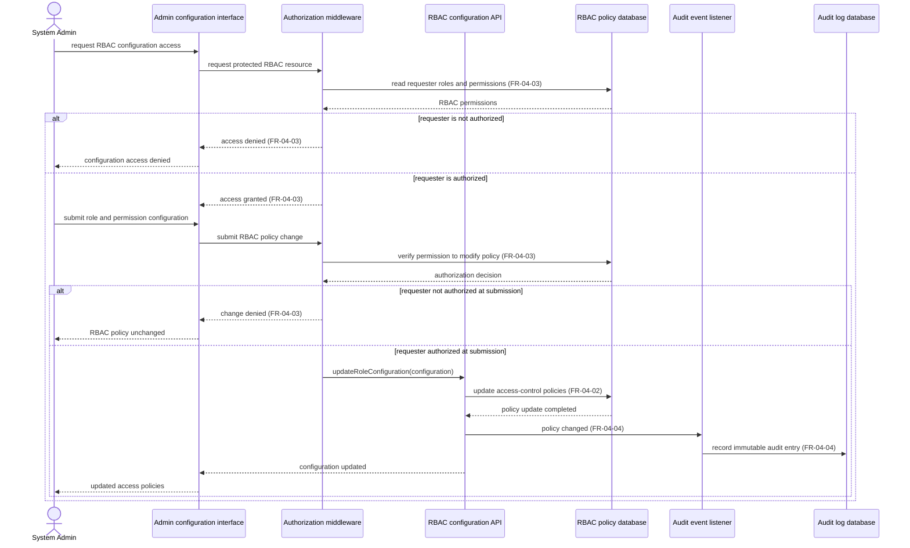

# Sequence Diagram: SD-UC-11 Configure Role-Based Access Control (RBAC) and system authorization

| Field | Value |
|---|---|
| Use case | **UC-11 Configure Role-Based Access Control (RBAC) and system authorization** |
| Version | v1.0 |
| FRs | **FR-04-02, FR-04-03 (UC-11 Must)**; shared **FR-04-04 (UC-12 Must)** |

