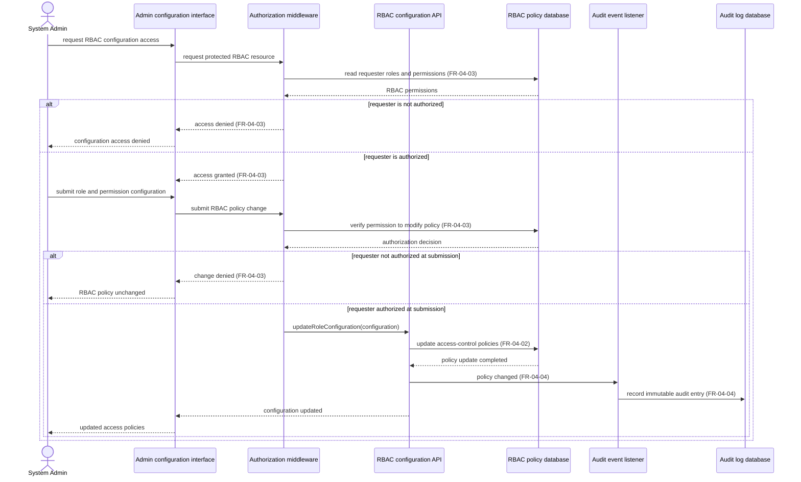

# Sequence Diagram: SD-UC-11 Configure Role-Based Access Control (RBAC) and system authorization

Lesson 4, analysis level: how EcoTrace components cooperate when a System Admin requests access to RBAC configuration and submits a role/permission policy change. The authorization choice and admin tasks appear in [AD-UC-11](../activity/AD-UC-11.md); this sequence focuses on component-to-component requests. 

| Field | Value |
|---|---|
| Use case | **UC-11 Configure Role-Based Access Control (RBAC) and system authorization** |
| Primary actor | System Admin |
| Version | v1.0 |
| FRs | **FR-04-02, FR-04-03 (UC-11 Must)**; shared **FR-04-04 (UC-12 Must)** |
| Sources | Midterm Excel W1: `FR-04-02-BE` role-definition/user-role mapping API; `FR-04-03-BE` global authorization middleware; `FR-04-04-BE` audit event listener and log DB; W4 Must; AD-UC-11 v0.1 |
| Preconditions | System Admin has already signed in (UC-10); this sequence does not repeat login. |

The `alt` fragments express **decisions made inside EcoTrace**: whether the requester may access or modify the protected RBAC resource. The second permission check is an **analysis-level application** of FR-04-03 (“before granting access”) to the protected *write* request, not a new business capability or a prescribed middleware implementation. If the team considers the first authorization sufficient, this second check can be removed after reviewing the architecture and security rules.

**Traceability and limits:** FR-04-02 requires updating stored RBAC policies when an admin submits role configurations. FR-04-03 requires checking permission before allowing a protected action. FR-04-04 (owned by UC-12, but applicable here) requires an immutable audit entry for system-altering actions. W1 lists an event listener that captures the action, user ID, timestamp, and payload. The exact interface name, permission IDs, error-handling policy, write-transaction design, and audit-failure behavior are **not specified**; therefore this draft does not invent an invalid-configuration branch, rollback/retry, or a rule that failed audit logging automatically reverses the policy update. The success path assumes the policy update and audit logging complete normally.
