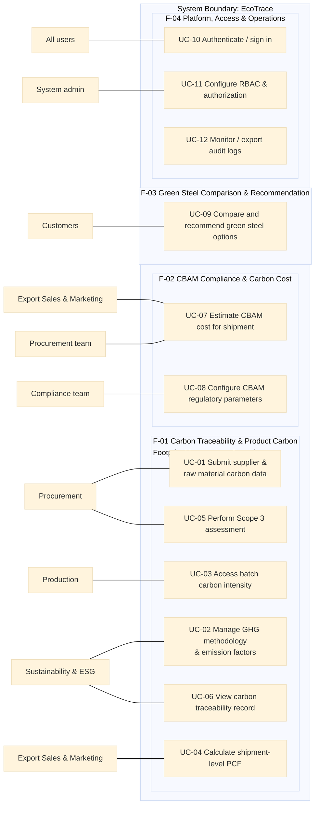

# Use Case Diagram: HPDQ

| Field | Value |
|---|---|
| Actors | Procurement, Sustainability & ESG, Export Sales & Marketing, Customers; Time (starts UC-01) |

## Diagram

## Sequence diagrams

One sequence diagram per use case, at analysis level: the lifelines are the elements of the
[physical design](../architecture/architecture.md).

| Use case | Sequence diagram | Status |
|---|---|---|
| UC-01 Submit supplier & raw material carbon data | [SD-UC-01](SD-UC-01.md) | Done (split from "Booking flow" after Lesson 7) |
| UC-02 Manage GHG methodology & emission factors |  [SD-UC-02](SD-UC-02.md)  | Open: still to be drawn (Inputs check row 4, Owner A) |
| UC-03 Access batch carbon intensity | [SD-UC-03](SD-UC-03.md) | Done |
| UC-04 Calculate shipment-level PCF | [SD-UC-04](SD-UC-04.md) | Done (split from "Booking flow" after Lesson 7) |
| UC-05 Perform Scope 3 assessment |  [SD-UC-05](SD-UC-05.md)  | Open: still to be drawn (Inputs check row 4, Owner A) |
| UC-06 View carbon traceability record | [SD-UC-06](SD-UC-06.md) | Done |
| UC-07 Estimate & analyze CBAM exposure for shipment | [SD-UC-07](SD-UC-07.md) | Done (split from "Booking flow" after Lesson 7) |
| UC-08 Manage CBAM regulatory rules & parameters |  [SD-UC-08](SD-UC-08.md)  | Open: still to be drawn (Inputs check row 4, Owner A) |
| UC-09 Compare and recommend green steel options | [SD-UC-09](SD-UC-09.md) | Done |
| UC-10 Authenticate and sign in to the platform | [SD-UC-10](SD-UC-10.md) | Done (split from "Booking flow" after Lesson 7) |
| UC-11 Configure Role-Based Access Control (RBAC) and system authorization |  [SD-UC-11](SD-UC-11.md)  | Open: still to be drawn (Inputs check row 4, Owner A) |
| UC-12 Monitor, track, and export system audit logs | [SD-UC-12](SD-UC-12.md) | Done |

## Change log

| Version | When | Change | Why |
|---|---|---|---|

